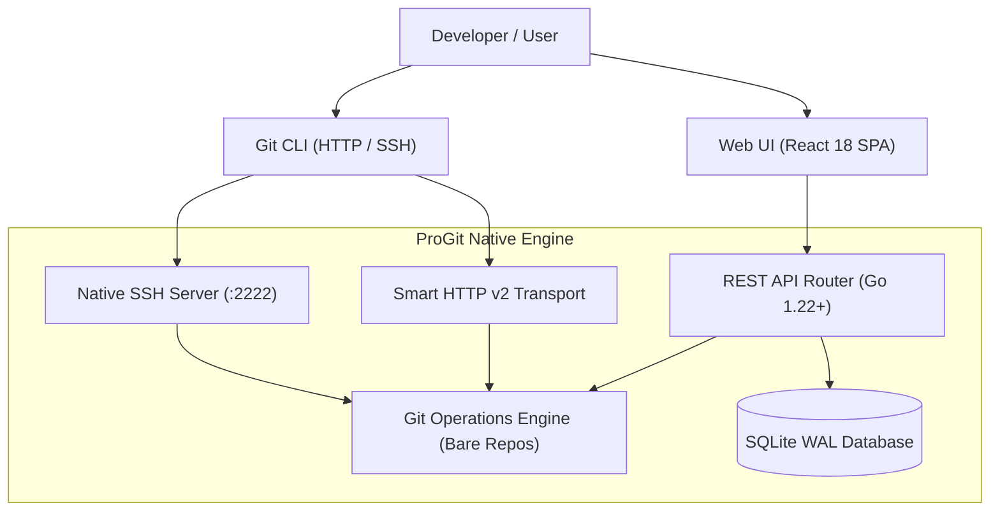

# ProGit Project State Snapshot

**Date:** November 2, 2026  
**Milestone Version:** `v1.1.0-stable`  
**Git Commit (main):** `7f0d12d`  
**Git Commit (docs):** `da99d5d`  
**Live Container:** `localhost/progit:latest` (`55a8a9b7b494`)  
**Backup Archive:** `backups/progit-backup-20261102-122415.tar.gz` (2.4 MB)

---

## 1. Executive Summary

The project is in a clean, tested, and fully functional milestone state. All core Git hosting features, web UI interfaces, documentation sites, and automated tests are operating with 100% test coverage across Go unit tests, bash E2E API tests, and Puppeteer UI automation.

---

## 2. Architecture & Technology Stack

| Component | Technology | Description |
|---|---|---|
| **Backend Runtime** | Go 1.23+ (Pure Go, Zero CGO) | Lightweight standalone binary compiled with `-trimpath -ldflags="-s -w"`. |
| **Database** | SQLite via `modernc.org/sqlite` | Embedded database running with Write-Ahead Logging (`PRAGMA journal_mode=WAL;`), foreign keys enabled, and automatic checkpointing. |
| **Git Engine** | Pure Go + Standard Git CLI | Implements Git v2 Smart HTTP transfer protocol (`upload-pack`, `receive-pack`) and custom SSH server. |
| **Frontend UI** | React 18 + TypeScript + Vite | Tailwind CSS styling, Lucide icons, PrismJS code highlighting, fully responsive desktop/tablet/mobile design. |
| **Containerization** | Podman / Docker (OCI) | Alpine 3.21 multi-stage build (~38 MB total image footprint). |
| **Documentation Site** | Static SPA (`docs` branch) | Single-page documentation portal with dynamic left-sidebar navigation, URL hash synchronization, search modal (⌘K), and theme toggler. |

---

## 3. Key Completed Features & Capabilities



### A. Repository Creation & Management
- **GitHub-Style Blank Repository Quick Setup**:
  - Displays instant clone URL switcher (HTTPS / SSH) with copy button.
  - Section 1: `…or create a new repository on the command line` with pre-filled terminal commands.
  - Section 2: `…or push an existing repository from the command line`.
  - Section 3: `…or import code from another repository` shortcut.
- **Repository Import Wizard (`/new/import` & `POST /api/v1/repos/import`)**:
  - Clones external repositories from GitHub, GitLab, Bitbucket, or any Git remote URL using `--mirror` / `--bare`.
  - Preserves entire commit histories, branches, and tags.
  - Supports private repositories with optional authentication credentials (Personal Access Tokens / Basic Auth).
  - Sanitizes sensitive credentials to prevent credential leakage in logs or responses.
- **Repository Code Explorer**:
  - GitHub-style latest commit banner with author avatar, commit message, short SHA badge, relative timestamp, and commit count.
  - Online file editor with 8 syntax themes (Prettier integration).
  - Online file creation (nested folder path support) and multi-file directory upload.

### B. User Experience & Dashboard
- **Dashboard Optimization**:
  - Compact single-line `Profile Overview` button with `w-3 h-3` icon.
  - Server-side pagination for Explore page (12 per page).
  - Client-side pagination for Dashboard Recent Activity (8 per page) and Top Repositories.
  - Responsive search bar with `/` keyboard focus shortcut and real-time autocomplete.

### C. Collaboration & Project Tools
- **Issues & Pull Requests**:
  - Issue tracking with comments, labels, and collaborator-scoped assignee guard.
  - Pull requests with unified side-by-side / inline diffs, review status, and atomic server-side merges.
- **Kanban Project Boards**:
  - Draggable columns (`To do`, `In progress`, `Done`, custom columns) and task cards.
- **Developer Direct Messaging**:
  - Internal messaging system with unread counts and real-time notifications.
- **Webhooks & Danger Zone**:
  - Event-driven webhooks with HMAC-SHA256 signatures and delivery logging.
  - Read-only archiving, visibility toggle, and repository ownership transfers.

---

## 4. Test Suite Baseline

| Suite | File / Runner | Total Tests | Status |
|---|---|:---:|:---:|
| **E2E Platform Suite** | `tests/e2e/qa_full_suite.sh` | 128 | **128 / 128 PASSED (100%)** |
| **Puppeteer UI Suite** | `tests/ui_test.mjs` | 45 | **45 / 45 PASSED (100%)** |
| **Go Internal Tests** | `go test ./internal/...` | 27 | **27 / 27 PASSED (100%)** |
| **Docs Navigation Test** | `tests/test_docs_navigation.mjs` | 11 | **11 / 11 PASSED (100%)** |

---

## 5. Branch & Deployment State

- **Branch `main` (`7f0d12d`)**: Core backend, frontend SPA, automated test suites, deployment scripts.
- **Branch `docs` (`da99d5d`)**: Documentation website (`docs/index.html` and `index.html`) with delegated navigation handlers.
- **Milestone Tag**: `v1.1.0-stable` pushed to `origin`.
- **Active Container**:
  ```bash
  podman ps
  # Container: progit (localhost/progit:latest)
  # Ports: 0.0.0.0:2222->2222, 0.0.0.0:3000->3000, 0.0.0.0:3443->3443
  # Volumes: progit-db, progit-repos, progit-config
  ```
- **Backup Snapshot**:
  `backups/progit-backup-20261102-122415.tar.gz` (2.4 MB) containing WAL-checkpointed SQLite database and all bare Git repositories.

---

## 6. Recommendations for Future Improvements

1. **OAuth2 / Social Authentication Providers**:
   - Add GitHub, GitLab, and Google OAuth2 login integration.
2. **CI/CD Pipeline Runner (ProGit Actions)**:
   - Build a lightweight runner to execute automated workflow scripts upon push / pull request events.
3. **GPG Commit Signing**:
   - Support uploading GPG public keys and displaying "Verified" badges next to signed commits.
4. **LFS (Large File Storage) Engine**:
   - Implement Git LFS pointer storage with local filesystem or S3 object store backends.
5. **Two-Factor Authentication (2FA / TOTP)**:
   - Add QR-code time-based one-time password verification for enhanced account security.
