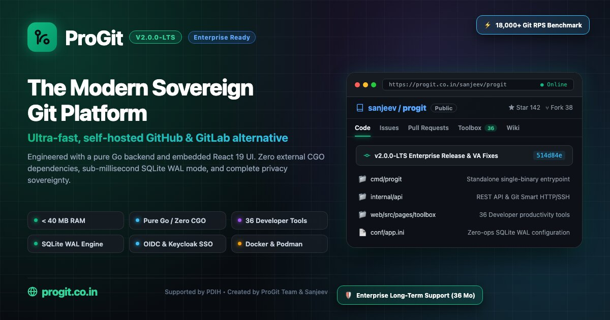
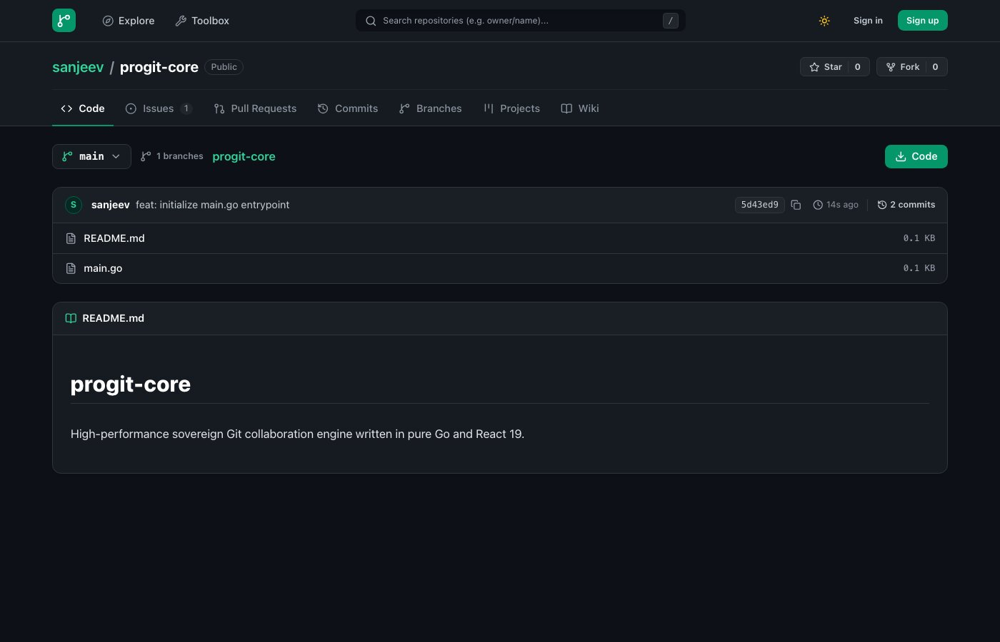
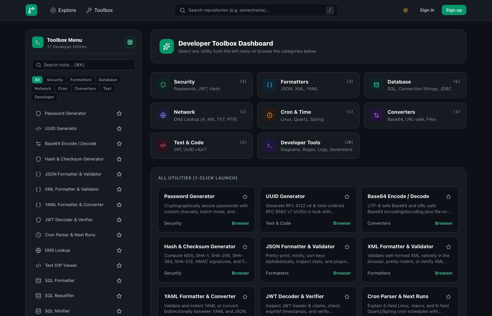
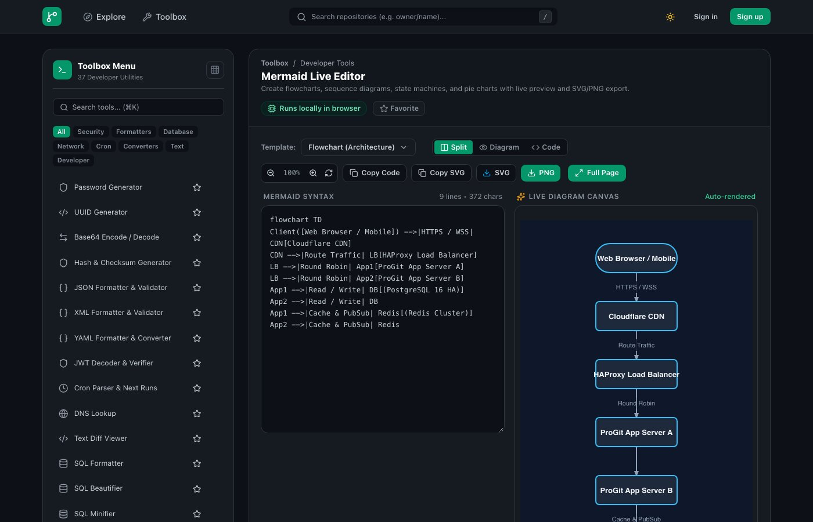
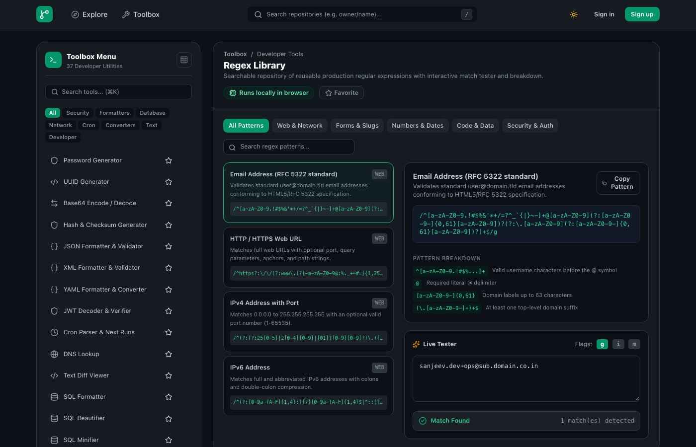
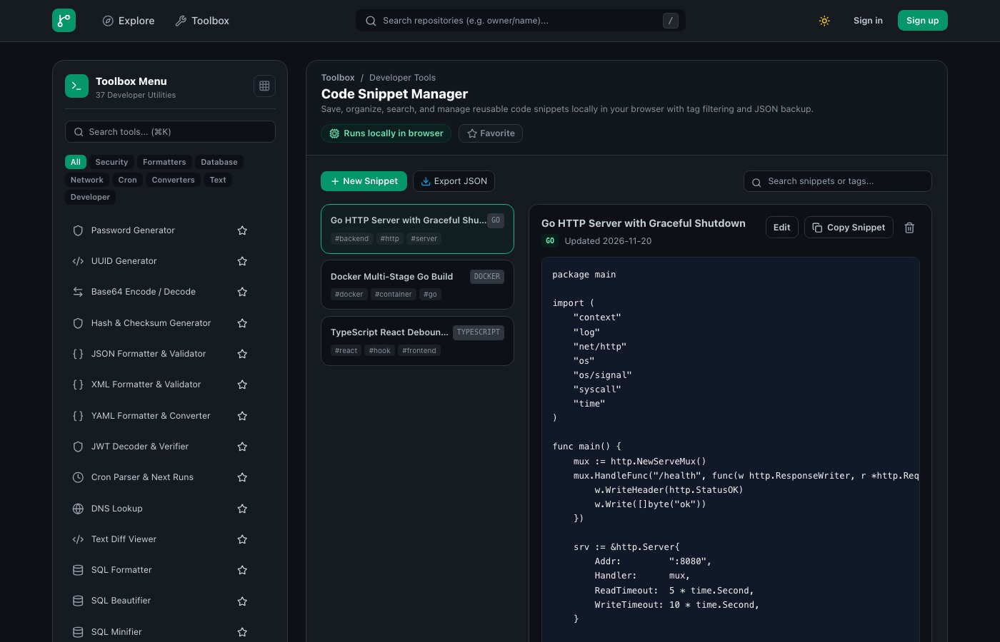

# ProGit

<p align="center">
  <strong>A modern, lightweight, self-hosted Git collaboration platform and GitHub alternative written in Go and React.</strong>
</p>

<p align="center">
  
  
  
  
  
  
  
</p>

<p align="center">
  
</p>

---

## Highlights

- **Enterprise Long-Term Support (LTS)**: Production-hardened v2.0.0-LTS release with guaranteed 36-month support lifecycle, vulnerability mitigations, and pure-Go runtime stability.
- **Single Static Binary**: Built with pure Go (`modernc.org/sqlite`, zero CGO) and embedded modern React single-page application using `embed.FS`.
- **Full Git Engine**: Native Git Smart HTTP (`git-upload-pack`, `git-receive-pack`) and integrated pure-Go SSH server on port 2222.
- **Developer Toolbox Suite**: Integrated 37-tool productivity suite including Mermaid Live Editor (with full-page view), Regex Library, Code Snippets, JSONPath/XPath testers, SQL/Stack Trace explainers, and media generators.
- **Modern GitHub-Like Experience**: React 19 + TypeScript + Vite + Tailwind CSS with dark mode, responsive layout, and reactive updates.
- **Git-Backed Wiki Engine**: Every repository features an independent, real Git-backed wiki (`<owner>/<repo>.wiki.git`) accessible via Web UI (Markdown preview, revisions, history) and Git CLI (HTTP/SSH).
- **ProGit Pages (GitHub Pages)**: Host static websites, portfolios, or documentation directly from `gh-pages` or `main` branches with automatic Markdown rendering and access control.
- **Complete Developer Collaboration**:
  - Issues & Labels, Milestones, and threaded Markdown comments.
  - Pull Requests with live syntax diffing, comparison, and native Git merges (Merge Commit, Squash, Rebase).
  - Branch protection, forks, stars, and activity feeds.

<p align="center">
  
</p>

- **OpenID Connect (OIDC) & OAuth2 SSO**: Native single sign-on with Google Workspace, GitHub, Microsoft 365, Keycloak, and generic OIDC providers with Just-In-Time (JIT) provisioning and corporate domain whitelisting.
- **Self-Hosted Administration**: First-run setup installation wizard, Super Admin management panel, runtime telemetry, and database WAL maintenance.

---

## Architecture Overview

```
                      +---------------------------------------+
                      |       Clients (Browser / Git CLI)     |
                      +-------------------+-------------------+
                                          |
                        HTTP / HTTPS (3000)   SSH (2222)
                                          |        |
                      +-------------------|--------|----------+
                      |                   v        v          |
                      |        ProGit Single Binary           |
                      |  +---------------------------------+  |
                      |  |     Embedded React 19 SPA       |  |
                      |  +---------------------------------+  |
                      |  |   REST API & Git Smart HTTP     |  |
                      |  +---------------------------------+  |
                      |  |     Native Pure-Go SSH Server   |  |
                      |  +---------------------------------+  |
                      |  | Git Operations (Repos & Wikis)  |  |
                      |  +---------------------------------+  |
                      |  |  SQLite Engine (WAL, Zero CGO)  |  |
                      |  +---------------------------------+  |
                      +-------------------|-------------------+
                                          |
                      +-------------------|-------------------+
                      |                   v                   |
                      |          Persistent Storage           |
                      |  - /data/db/progit.db (WAL mode)      |
                      |  - /data/repositories/<user>/<repo>   |
                      |  - /data/config/                      |
                      +---------------------------------------+
```

---

## 🛠️ Developer Productivity Toolbox (37 Built-in Tools)

ProGit features a built-in, zero-overhead developer productivity suite at `/toolbox` with instant fuzzy search (`Cmd+K` / `Ctrl+K`), local-first offline execution, and browser favorites:

<p align="center">
  
</p>

### Highlighted Capabilities

- **Mermaid Live Editor (with Full Page View)**: Interactive flowchart, sequence diagram, state machine, and pie chart editor with live preview, SVG/PNG download, and full-screen overlay mode.
  <p align="center">
    
  </p>

- **Regex Library & Live Tester**: Comprehensive pattern directory (web, forms, security, code) with real-time match highlighting and regex capture group extraction.
  <p align="center">
    
  </p>

- **Code Snippet Vault & JSONPath Tester**: In-browser reusable code snippet manager with tag filters, syntax highlighting, and live JSONPath evaluator.
  <p align="center">
    
  </p>

### Complete Directory of 37 Utilities

| Category | Count | Tools Included |
| :--- | :---: | :--- |
| **Developer Productivity** | 20 | Mermaid Live Editor (with Full Page View), Regex Library, Code Snippets, JSONPath Tester, XPath Tester, SQL Query Explainer, Stack Trace Explainer, Error Code Search, Log Analyzer, Log Pattern Extractor, CSV Viewer, Markdown Editor, Markdown Table Generator, Color Picker, CSS Gradient Generator, SVG Optimizer, QR Code Generator, Barcode Generator, Image Compressor, Favicon Generator |
| **Database Suite** | 6 | SQL Formatter, SQL Beautifier, SQL Minifier, SQL Validator, Connection String Builder, Java JDBC URL Generator |
| **Security & Crypto** | 3 | Password Generator (`crypto.getRandomValues`), JWT Decoder & Verifier, Hash & Checksum Generator (MD5/SHA/HMAC) |
| **Formatters & Converters**| 4 | JSON Formatter/Validator, XML Formatter/Validator, YAML Formatter & YAML ↔ JSON, Base64 Encode/Decode |
| **Network** | 1 | Server-assisted DNS Lookup (A, AAAA, CNAME, MX, TXT, NS, PTR) |
| **Cron & Scheduling** | 1 | Cron Expression Parser (Linux 5-field, Quartz 6-field, Spring) + Next 10 Runs |
| **Text & Identifiers** | 2 | Text Diff Viewer (Side-by-side & Unified), UUID Generator (v4 & RFC 9562 v7 time-ordered) |

---

## Quickstart with Docker & Podman

ProGit provides production-grade containerization with zero CGO dependencies and automated HTTPS:

### Quick Start with Docker
```bash
# 1. Clone repository
git clone https://github.com/sanjeevsenapati/progit.git
cd progit

# 2. Launch with Docker Compose
docker compose up -d

# Or run the automated deployment script:
./docker/deploy.sh
```
> See the [Docker Deployment Guide (docs/DOCKER_DEPLOYMENT.md)](docs/DOCKER_DEPLOYMENT.md) for full instructions, multi-arch tags, backups, and reverse proxy recipes.

### Quick Start with Podman
```bash
# 1. Clone repository
git clone https://github.com/sanjeevsenapati/progit.git
cd progit

# 2. Deploy container with persistent volumes
./podman/deploy.sh

# 3. Run the functional integration test suite
./podman/test.sh
```
> See the [Podman Deployment Guide (docs/PODMAN_DEPLOYMENT.md)](docs/PODMAN_DEPLOYMENT.md) for rootless execution, RHEL 9 manual setup, and systemd integration.

Navigate to `https://localhost:3443` (or `http://localhost:3000`) in your web browser.

---

## Building from Source

### Prerequisites
- Go 1.22+
- Node.js 20+ & npm

### Build Steps

```bash
# 1. Build frontend assets
cd web
npm install
npm run build
cd ..

# 2. Synchronize frontend bundle for Go embedding
rm -rf internal/ui/dist && cp -r web/dist internal/ui/dist

# 3. Compile the standalone binary
CGO_ENABLED=0 go build -o progit ./cmd/progit

# 4. Start ProGit
./progit web
```

---

## CLI Management Commands

ProGit includes CLI subcommands for maintenance and user management:

```bash
# Create an Administrator
./progit admin create-user --username=admin --email=admin@example.com --password=SecretPassword123! --admin

# List Users
./progit admin list-users

# Check database and health
curl http://localhost:3000/api/health
```

---

## Documentation

Detailed architectural and deployment documentation is available in the [`docs/`](./docs) directory:
- [Release Cycle & Version Management Policy](./docs/RELEASE_CYCLE_AND_VERSIONING.md)
- [Architecture & Design Decisions](./docs/ARCHITECTURE.md)
- [Feature Inventory & Roadmap](./docs/FEATURE_INVENTORY.md)
- [Database Design & Schema](./docs/DATABASE_DESIGN.md)
- [REST API Specification](./docs/API_DESIGN.md)
- [Security Model & Hardening](./docs/SECURITY.md)
- [User Guide & Workflows](./docs/USER_GUIDE.md)
- [Podman Deployment & Operations](./docs/PODMAN_DEPLOYMENT.md)
- [Platform Changelog](./CHANGELOG.md)

---

## 📜 Attribution & Credits

Supported by **PDIH** and created by **ProGit Team and Sanjeev**.  
Built on top of the Gogs source code. Released under the open-source MIT License.

---

## License

ProGit is licensed under the [MIT License](./project.md).

