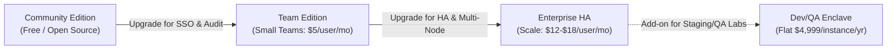

# ProGit Enterprise: Multi-Node High Availability (HA) Architecture & Commercial Strategy

---

## Executive Summary

ProGit has evolved into a high-performance, single-binary enterprise Git platform with low resource consumption, an embedded React interface, full SSH/HTTPS Git mechanics, and zero external runtime dependencies. 

While the single-node architecture delivers industry-leading simplicity (< 100 MB RAM, sub-second startup), mid-market IT firms and enterprise engineering teams require **Multi-Node High Availability (HA)** to eliminate single points of failure (SPOF), achieve 99.99% service level agreements (SLAs), and support disaster recovery (DR). Furthermore, enterprise Dev/QA environments often require independent, air-gapped, or ephemeral staging Git clusters where per-seat pricing models from GitHub Enterprise ($21/user/mo) or GitLab Ultimate ($99/user/mo) are cost-prohibitive.

This blueprint establishes:
1. **The Technical HA Architecture**: Stateless application nodes, distributed Git storage engine, clustered database backends, and zero-downtime rolling upgrades.
2. **The Commercial & Monetization Model**: Competitive tiered licensing (per-seat and flat-instance models) engineered for SMBs and enterprise dev/testing environments.
3. **The Implementation Roadmap**: Concrete development phases to transition ProGit from single-node to a clustered enterprise solution without sacrificing lightweight efficiency.

---

## Part 1: Multi-Node High Availability (HA) Architecture

### 1.1 Architecture Topology

A scalable, resilient ProGit HA cluster splits concerns into four distinct tiers:
1. **Edge Routing & Ingress Tier**: High-availability load balancers routing HTTPS and Git SSH traffic.
2. **Stateless Compute Tier (`progit-core`)**: Multiple application instances serving API, Web UI, and orchestrating Git operations.
3. **Clustered Metadata & Cache Tier**: Multi-master or primary-replica PostgreSQL with Redis/Dragonfly for distributed locks and cache.
4. **Resilient Git Storage Tier (`progit-storage`)**: Replicated block storage or dedicated gRPC-based storage nodes.

```mermaid
flowchart TD
    subgraph ClientLayer["Clients & Integrations"]
        WebDev["Developers (Web & CLI)"]
        CI["CI/CD Runners & Bots"]
    end

    subgraph IngressLayer["Edge Routing & Load Balancing (HAProxy / Cloud NLB)"]
        LB1["Ingress Node 1 (Active)"]
        LB2["Ingress Node 2 (Standby)"]
        LB1 <-->|Keepalived / VRRP| LB2
    end

    subgraph ComputeTier["Stateless ProGit Compute Nodes"]
        Node1["ProGit App 1\n(HTTP 3000 / SSH 2222)"]
        Node2["ProGit App 2\n(HTTP 3000 / SSH 2222)"]
        Node3["ProGit App 3\n(HTTP 3000 / SSH 2222)"]
    end

    subgraph CacheCluster["Distributed Cache & Locks"]
        Redis["Redis Sentinel / Redis Cluster\n(Sessions, PubSub, Git Locks)"]
    end

    subgraph DatabaseCluster["Enterprise Database Tier"]
        DBPrimary[("PostgreSQL Primary\n(Read/Write)")]
        DBStandby1[("PostgreSQL Standby 1\n(Hot Read Replica)")]
        DBStandby2[("PostgreSQL Standby 2\n(Hot Read Replica)")]
        DBPrimary -->|Patroni Streaming Replication| DBStandby1
        DBPrimary -->|Patroni Streaming Replication| DBStandby2
    end

    subgraph StorageTier["Replicated Git Storage Tier"]
        StorageCluster["Replicated POSIX / CephFS / AWS EFS\nOR\nDedicated ProGit Storage Daemons (gRPC Quorum)"]
    end

    ClientLayer --> IngressLayer
    IngressLayer -->|HTTPS (Round Robin)| ComputeTier
    IngressLayer -->|SSH (Proxy Protocol v2)| ComputeTier

    ComputeTier <--> CacheCluster
    ComputeTier -->|Read/Write| DBPrimary
    ComputeTier -.->|Read Only| DBStandby1
    ComputeTier -.->|Read Only| DBStandby2

    ComputeTier <--> StorageTier
```

---

### 1.2 Component Breakdown & HA Mechanics

#### A. Ingress & Load Balancing
- **HTTPS Traffic (Port 443 / 3000)**:
  - Managed by cloud Load Balancer (AWS ALB, GCP HTTPS LB) or on-premise HAProxy/Keepalived pairs.
  - Terminate TLS or pass through with SNI.
  - Health checks against `GET /healthz` (verifying database connectivity and local storage reachability).
- **Git SSH Traffic (Port 22 / 2222)**:
  - Layer-4 TCP balancing with PROXY protocol v2 to preserve client source IPs for audit logs and security firewalls.
  - All compute nodes share the same SSH Host Key pairs mounted from a shared secret/vault to eliminate SSH host key mismatch warnings (`Host key verification failed`).

#### B. Stateless Compute Nodes (`progit-core`)
- Application instances maintain **zero local state**.
- User authentication tokens (JWT) are signed with an asymmetric ECDSA/RSA key pair or shared secret loaded via environment/secrets manager.
- Session invalidation, brute-force rate-limiting, and repository write-locking are coordinated via Redis.
- If any node crashes, remaining nodes pick up incoming requests with zero user disruption.

#### C. Database Architecture: Evolution from SQLite to HA PostgreSQL
While SQLite is ideal for single-node installations, true active-active multi-node write scaling requires transitioning to or supporting PostgreSQL:
- **Pluggable DB Driver**: Implement a repository interface allowing both SQLite (single-node) and PostgreSQL (clustered).
- **High Availability via Patroni + PgBouncer**:
  - Primary handles writes; hot standbys handle read-heavy dashboard and repository browsing queries.
  - Automatic failover within 10 seconds via Raft/etcd consensus.
- **Alternative for Edge/Air-gapped HA (LiteFS / rqlite)**:
  - For small deployments desiring zero external dependencies, embed **LiteFS** (FUSE-based transactional replication for SQLite) or **rqlite** (distributed SQLite over Raft).

#### D. Distributed Git Storage Tier
Git repositories consist of loosely coupled objects, packfiles, and mutable references (`refs/heads/*`). Filesystem latency and locking are critical to avoid repository corruption.

Two architectures for ProGit HA Storage:

| Model | Architecture | Complexity | Recommended For |
| :--- | :--- | :--- | :--- |
| **Model 1: Replicated Shared POSIX Filesystem** | NFS v4.2 with lock leasing, CephFS, GlusterFS, or AWS EFS Max I/O. Repositories mounted directly at `/data/repos`. | Low to Medium | Small-to-Midsize businesses (SMBs), on-premise virtualization, rapid HA setup. |
| **Model 2: Storage RPC Daemon (Gitaly / Praefect Pattern)** | Dedicated lightweight `progit-storage` nodes communicating with compute nodes via gRPC with Raft consensus replication. | High | Large scale enterprises, multi-region deployments, high concurrent write loads. |

**Recommended Path for ProGit**: Begin with **Model 1 (POSIX-compliant distributed filesystem + Redis Distributed File Locking)**. This provides 99.99% reliability with existing Git binaries while avoiding the complex custom gRPC replication layer in early enterprise releases.

---

### 1.3 High Availability SLAs & Recovery Metrics

| Metric | Target | Technical Mechanism |
| :--- | :--- | :--- |
| **RPO (Recovery Point Objective)** | < 1 second | Continuous PostgreSQL streaming replication + synchronously mirrored block storage (Ceph/DRBD/EFS). |
| **RTO (Recovery Time Objective)** | < 30 seconds | Automated health probes trigger LB node deregistration (5s); Patroni DB failover (10-15s). |
| **Uptime SLA** | 99.95% - 99.99% | N+1 compute redundancy; automated zero-downtime rolling schema migrations. |

---

## Part 2: Enterprise Target Market & Competitive Landscape

### 2.1 Target Customer Personas

#### Persona 1: Small and Medium IT Companies & Agencies (20 to 500 Engineers)
- **Current Frustration**:
  - GitHub Enterprise Cloud ($21/user/mo) and GitLab Ultimate ($99/user/mo) represent significant ongoing SaaS line items ($12,000 to $120,000+ annually).
  - GitLab Self-Managed is notoriously resource-heavy (demands 8–16 GB RAM minimum, heavy Ruby/Gitaly stack, frequent version migration friction).
  - Self-hosted alternatives like Gitea or Forgejo often lack polished out-of-the-box enterprise compliance, modern React UX, or turnkey commercial SLAs.
- **ProGit Proposition**:
  - Ultra-lightweight footprint (under 250 MB RAM per cluster node).
  - Modern, GitHub-standard UI and developer workflows.
  - Predictable pricing at 60-70% savings compared to GitHub/GitLab.

#### Persona 2: Enterprise Dev, QA, Staging & Ephemeral Test Enclaves
- **Current Frustration**:
  - Large enterprises using GitHub Enterprise Server in production cannot afford to spin up identical sandbox/staging clusters for automated pipeline testing, load testing, or QA verification due to seat-licensing restrictions.
  - CI/CD bots, automated test accounts, and ephemeral review environments quickly exhaust paid seat licenses.
- **ProGit Proposition**:
  - **Flat-Instance / Enclave Licensing**: Deploy unlimited users and test bots within dedicated QA, staging, or sandbox environments.
  - Fully air-gapped support with zero outbound telemetry requirements.

---

### 2.2 Competitive Comparison

| Feature / Metric | ProGit Enterprise | GitHub Enterprise Server | GitLab Self-Managed | Gitea / Forgejo |
| :--- | :--- | :--- | :--- | :--- |
| **Resource Footprint** | **Ultra-Low (< 200 MB)** | Heavy (32 GB RAM min) | Heavy (16 GB RAM min) | Low (< 500 MB) |
| **Startup / Boot Time** | **< 2 Seconds** | 10–15 Minutes | 5–10 Minutes | < 5 Seconds |
| **Single-Binary Simplicity** | **Yes (Pure Go + React)** | No (Multi-VM / Appliance) | No (Omnibus / 20+ services)| Yes |
| **Multi-Node HA Mode** | **Yes (Compute + DB + FS)**| Yes (High licensing tier) | Yes (Premium/Ultimate only) | Limited / Complex |
| **Air-Gapped Deployment** | **100% Native** | Supported | Supported | Supported |
| **Test Enclave License** | **Flat Instance (No Seat Limit)**| Per-Seat Only ($21/seat) | Per-Seat Only ($29-$99/seat)| Free / Community |
| **Commercial 24/7 SLA** | **Turnkey Enterprise** | Expensive Enterprise Tier| Premium Tier Required | Third-party / Community|

---

## Part 3: Commercial & Payment Model Strategy

### 3.1 Edition & Tier Structure



#### Tier 1: Community Edition (Open Source - Apache 2.0 or MIT)
- **Target**: Solopreneurs, open-source projects, small hobby teams.
- **Capabilities**:
  - Single-node deployment.
  - Unlimited public and private repositories.
  - SQLite database backend.
  - Embedded web UI, Git HTTP/SSH, Wikis, Issues, Releases.
  - Basic Webhooks.
  - Community support via GitHub Discussions and Discord.

#### Tier 2: ProGit Team (Commercial - $6 / user / month billed annually)
- **Target**: Growing IT startups and small agencies (10 to 50 developers).
- **Capabilities**:
  - Single-node deployment with enterprise integrations.
  - **Single Sign-On (SSO)**: Google Workspace, GitHub OAuth, Microsoft Entra ID.
  - **LDAP / Active Directory Integration**.
  - Advanced Branch Protection Rules (mandatory reviewers, signed commits).
  - Automated Cloud Backups (S3 / GCS / Azure Blob).
  - Standard Business Support (8x5, 24-hour response SLA).

#### Tier 3: ProGit Enterprise HA (Commercial - $15 / user / month billed annually)
- **Target**: Mid-market IT firms and regulated organizations (50 to 2,000+ developers).
- **Capabilities**:
  - **Full Multi-Node High Availability (HA)** clustering.
  - Clustered PostgreSQL backend support.
  - SAML 2.0 / OIDC Enterprise Single Sign-On + SCIM user provisioning.
  - **Comprehensive Audit & Compliance Logging** (CEF/JSON streaming to Splunk, Datadog, Elastic).
  - Fine-grained Role-Based Access Control (RBAC).
  - Secret scanning and pre-receive commit hooks.
  - Priority Enterprise Support (24x7x365, 1-hour critical response SLA, dedicated Technical Account Manager).

#### Tier 4: Enterprise Dev/QA Enclave License (Special Flat-Fee Model)
- **Target**: Enterprise QA departments, test staging clusters, ephemeral dev environments, air-gapped defense/fintech labs.
- **Pricing**: **$4,999 to $9,999 per instance / cluster per year (Unlimited Users & Bots)**.
- **Key Selling Point**: Large enterprises already paying GitHub/GitLab for production can deploy ProGit across 10+ staging and CI/CD test clusters without incurring massive per-seat licensing penalties for automated test runners.

---

### 3.2 Total Cost of Ownership (TCO) Comparison (100 Engineers)

| Expense Item | GitHub Enterprise Server | GitLab Ultimate | ProGit Enterprise HA |
| :--- | :--- | :--- | :--- |
| **Annual Seat Licenses** | $25,200 ($21/user/mo) | $118,800 ($99/user/mo) | **$18,000 ($15/user/mo)** |
| **Infrastructure Hosting (Cloud VMs)**| ~$7,200/yr (32 GB RAM VMs) | ~$9,600/yr (Heavy multi-node) | **$2,400/yr (Lightweight Go containers)** |
| **Staging/QA Lab Overhead** | Extra per-seat fees or skipped | Extra per-seat fees or skipped | **Included / Discounted Flat Enclave** |
| **Estimated Annual Total** | **$32,400** | **$128,400** | **$20,400 (~37% to 84% Savings)** |

---

### 3.3 License Enforcement: Air-Gapped Cryptographic Signature

In enterprise and defense dev environments, systems **cannot phone home** over the internet to validate licenses.

**Architecture for Offline License Validation**:
1. When a customer purchases a subscription, an offline JSON license file is generated:
   ```json
   {
     "customer_id": "cust_enterprise_88291",
     "company_name": "Acme Defense Technologies",
     "edition": "enterprise_ha",
     "max_seats": 250,
     "cluster_mode": true,
     "valid_from": "2026-11-01T00:00:00Z",
     "valid_until": "2027-11-01T00:00:00Z",
     "features": ["ha", "saml", "audit_log", "postgres", "ldap"],
     "signature": "MEQCIF6x...cryptographic_ecdsa_signature..."
   }
   ```
2. The license payload is signed with ProGit's private 4096-bit RSA or Ed25519 root master key.
3. The ProGit binary contains only the public verification key.
4. On startup and every 24 hours, ProGit validates the signature locally in memory:
   - Zero outbound HTTP network requests.
   - 30-day graceful expiration window with banner alerts before administrative lock.

---

## Part 4: Technical Migration Roadmap (Single-Node to HA)

To implement Multi-Node HA without breaking existing single-node installations, execute in three structured engineering phases:

### Phase 1: Database Abstraction & PostgreSQL Driver (Weeks 1–4)
- Abstract direct SQLite database interactions into an interface (`DatabaseStore`).
- Implement PostgreSQL adapter using `pgx` (pure Go, high-concurrency connection pooling).
- Support automated database migration scripts (Go `golang-migrate` or custom SQL schema versioning) compatible with both SQLite and Postgres.
- Add database configuration flags to `app.ini` / `config.yaml`:
  ```yaml
  database:
    type: postgres # or sqlite
    host: db-primary.internal
    port: 5432
    user: progit
    password: "${DB_PASSWORD}"
    name: progit_prod
    sslmode: verify-full
    max_open_conns: 50
    max_idle_conns: 10
  ```

### Phase 2: Distributed State & Shared Cache (Weeks 5–8)
- Externalize all in-memory caching and session state to an optional Redis layer.
- Implement distributed repository write locking:
  - When a user pushes via SSH/HTTPS, acquire a distributed mutex in Redis (`lock:repo:<owner>/<repo>`) with a 60-second TTL.
  - Prevents race conditions when two concurrent pushes hit different compute nodes targeting the same repository.
- Synchronize SSH host keys across nodes via shared volume or DB storage.

### Phase 3: Clustered Health Probes & Disaster Recovery (Weeks 9–12)
- Implement `/healthz` and `/readyz` endpoints with granular subsystem status (DB check, storage write test, Redis ping).
- Add automated S3/GCS continuous repository replication daemon for multi-region backup and instant disaster recovery (RPO < 5 mins).
- Deliver standardized Kubernetes Helm charts and Docker Compose production stacks for HA deployment with HAProxy, Patroni, and Redis Sentinel.

---

## Conclusion & Recommended Next Step

ProGit is positioned in the sweet spot between bloated legacy enterprise solutions (GitLab) and barebones single-server tools. By introducing:
1. **Model 1 HA (Stateless Compute + HA PostgreSQL + Shared Resilient POSIX Storage)**, and
2. **A Developer-Friendly Commercial Model ($15/seat for Enterprise HA, flat fee for Dev/QA Enclaves)**,

ProGit can quickly capture market share in small-to-midsize tech companies and enterprise QA environments seeking rapid, resource-efficient, and cost-effective source control.

